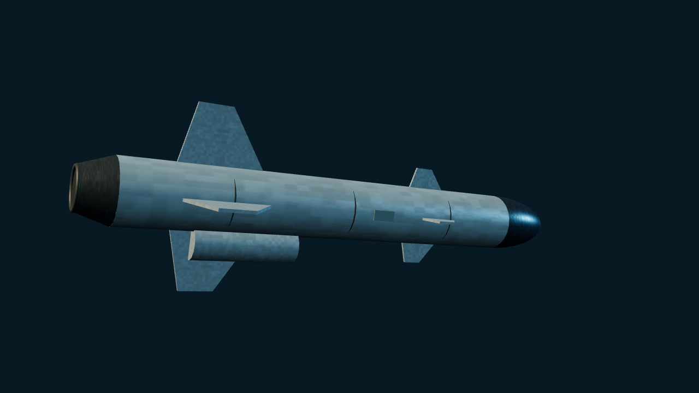

# RBS-15 Mk. II 反舰导弹

> 当前主分支 · Unreleased。仅 Mk. II，不含 Mk. III／IV 的对陆、GPS 或远程能力。

[武器目录](README.md) · [参数表](MISSILE_PARAMETERS.md) · [English](../en/WEAPONS/RBS15_MK2.md)

## 公开资料与型号边界

瑞典 Saab 的亚音速掠海反舰导弹。Mk. II 使用涡喷巡航、惯导和主动雷达末制导；舰射助推器在巡航阶段已分离。公开型号史记载 Mk. II 于 1998 年开始生产，**晚于默认冷战场景年代**，本项目只将其提供为可选沙盒来袭。

公开资料对 Mk. II 射程有“70 km 以上”和约 100 km 两种描述，本页保留分歧，不借用 Mk. III 的 200 km 或 Mk. IV 的 300 km 以上数据。系列常见外形尺度约为长 4.35 m、直径 .5 m、翼展 1.4 m；Saab 当前页面的尺寸及约 200 kg 战斗部表格明确列给 Mk. III／Gungnir，不能作为 Mk. II 独立实测表。这里仅将其作为系列外形参考，不据此推导现实命中率或毁伤。

## 外形与游戏实现

- 稳定 ID：`RBS-15 Mk. II`；定义：`src/threats/rbs15.ts`；预设：`RBS-15 RAID`。
- 参考标有 RB 15 Mk II 的博物馆照片，使用较粗弹体、深色圆钝雷达罩、前部小舵面、后部大翼及圆形腹部进气结构；展示已脱离助推器的巡航外形。
- 巡航／末段高度 `.3 / .1`、速度 `5.8 / 6.4`、伤害 `24`、RCS `.17` 均为游戏平衡值。生成距离 `460` 世界单位不是现实最大射程；伤害也不是按战斗部质量直接换算。
- 仅支持 `in-flight` 波次，不新增发射舰、岸基车或飞机挂载。沿用雷达、SAM／CIWS、ECM、箔条及 AAR／Tacview 流程；不启用 HOJ、跃升、蛇形或对陆能力。
- 预生成来袭沿用简化末段激活和反制偏转，不新增独立导引头捕获／失锁状态机、真实涡喷动力曲线或后期型号航路规划。

## 来源与核对说明

核对日期：2026-10-24。

- [RBS 15 — Wikipedia](https://en.wikipedia.org/wiki/RBS_15)：Mk. II 型号史、动力与制导；正文和型号表的射程描述存在差异。
- [Saab RBS15 family](https://www.saab.com/products/the-rbs15-family)：用于确认当前 Mk. III／IV 产品边界，未将其远程、GPS、对陆能力赋予 Mk. II。
- [RB 15 Mk II 博物馆照片](https://commons.wikimedia.org/wiki/File:RBS_15_MM_24325.jpg)：外形核对。仓库只提交自行渲染的程序化模型截图，不分发该照片。
