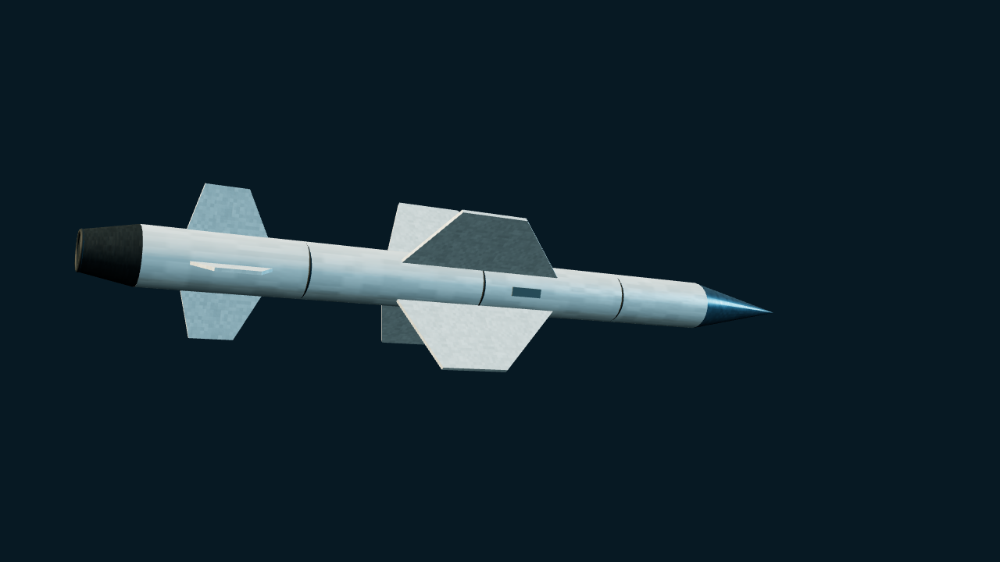

# Exocet MM38

> Current main · Unreleased. Early ship-launched MM38, not AM39, SM39 or MM40.

[Weapons](README.md) · [Parameters](MISSILE_PARAMETERS.md) · [中文](../../WEAPONS/MM38_EXOCET.md)

## Public references and variant boundary

French early ship-launched Exocet variant, developed from 1967 and in service from 1975. The CSIS MM38 entry gives approximately 5.21 m length, .35 m diameter, 735 kg launch mass, a 165 kg HE fragmentation warhead and 40 km range. It uses solid-propellant boost/sustain propulsion, inertial navigation and terminal active radar guidance in subsonic sea-skimming flight.

These figures describe MM38. Do not import the family infobox or MM40 Block 3's turbojet, 180–200 km range, GPS/land attack, or confuse the ship-launched MM38 with air-launched AM39. Public performance is background information, not evidence for game detection ranges, penetration probabilities or damage.

## Appearance and game implementation

- Stable ID: `MM38 Exocet`; definition: `src/threats/exocet.ts`; preset: `EXOCET RAID`.
- Slender body, pointed radome, large swept cruciform main wings and smaller aft controls, with offset wing planes and **no turbojet intake**. This is a recognizable procedural silhouette, not engineering CAD.
- Cruise/terminal altitude `.3 / .1`, speed `5.8 / 6.4`, damage `20` and RCS `.13` are game parameters. Spawn distance `340` world units is not real range. The shared flight model does not simulate a full solid-rocket thrust/coast curve.
- `in-flight` waves only: no new ships or aircraft loadouts, and no launch through Moskva slots. Reuse radar, SAM/CIWS, ECM, chaff and AAR/Tacview; no inherited Harpoon HOJ, pop-up or weaving.
- Retain simplified pre-spawned terminal activation and countermeasure diversion, without adding an independent seeker acquisition/loss state machine.

## Sources

Consulted 2026-10-24.

- [CSIS Missile Threat — Exocet](https://missilethreat.csis.org/missile/exocet/): specifically the **Exocet MM38** section for dates, dimensions, mass, warhead, range, propulsion and guidance, not another variant's figures.
- [Exocet — Wikipedia](https://en.wikipedia.org/wiki/Exocet): family history and variant cross-check; its lead image is AM39 and is not presented as MM38.
